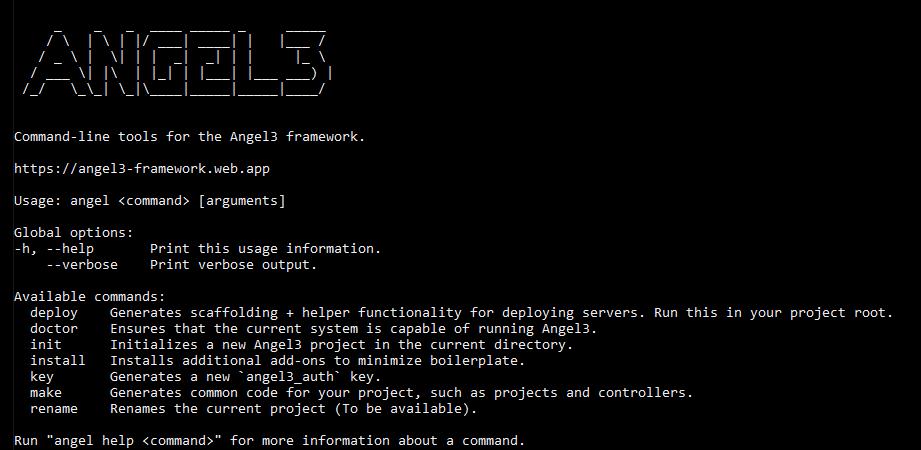

# Angel3 CLI

[](https://github.com/dart-backend/angel3-cli)


[](https://gitter.im/angel_dart/discussion)
[](https://github.com/dart-backend/angel3-cli/blob/master/LICENSE)

The command line interface for building Dart backends with the [Angel3 framework](https://pub.dev/packages/angel3_framework). It:

* creates a project from a starter template
* generates controllers, services, models, migrations, plug-ins and tests
* generates NGINX and systemd configuration for deployment
* generates new JWT secrets

## Installation

```bash
dart pub global activate angel3_cli
```

Make sure the Dart pub cache's `bin` folder is on your `PATH`, so that the `angel3` command is found.

## Creating a project

```bash
angel3 init my_app
```

`angel3 init` asks for a template, then:

1. downloads the templates from the [boilerplates](https://github.com/dart-backend/boilerplates) repository, and caches them in `~/.angel3/boilerplates` for a day
2. copies the chosen template into `my_app`, and names the package `my_app`
3. generates new JWT secrets in `config/default.yaml` and `config/production.yaml`
4. runs `dart pub get`, and `dart run build_runner build` for the templates that need code generation

| Template | Description |
| --- | --- |
| Basic | A basic web application with Jael views and static files |
| ORM for PostgreSQL | The basic application, with the Angel3 ORM and migrations on PostgreSQL |
| ORM for MySQL/MariaDB | The basic application, with the Angel3 ORM and migrations on MySQL or MariaDB |
| GraphQL | A to-do list served over GraphQL, stored in PostgreSQL with the Angel3 ORM |
| MongoDB | The basic application, with a REST API of a MongoDB collection (`angel3_mongo`) |
| RethinkDB | The basic application, with a REST and WebSocket API of a RethinkDB table, which pushes its changefeed to clients (`angel3_rethinkdb`, `angel3_websocket`) |
| Sembast | The basic application, with a REST API of a store in Sembast, a database in one file that needs no server (`angel3_sembast`) |

Then follow the `README.md` of the new project to set up its database, if any, and run it.

Options:

| Option | Description |
| --- | --- |
| `-n`, `--project-name` | The name of the project, instead of the folder's |
| `--refresh` | Download the latest templates, even if the cached ones are recent |
| `--offline` | Use the cached templates only, and skip `dart pub get` |
| `--no-pub-get` | Skip `dart pub get` and code generation |

If the download fails, `angel3 init` uses the cached templates when there are any. An existing folder is only deleted, after you confirm it, once a template is available.

## Commands

Run these from the root of your project.

| Command | Description |
| --- | --- |
| `angel3 init [<folder>]` | Creates a project from a starter template (see above) |
| `angel3 make controller` | Generates a controller class (`-w` for a WebSocket controller) |
| `angel3 make service` | Generates a service |
| `angel3 make model` | Generates a model class, serializable and with a migration by default (`--no-serializable`, `--no-migration`), and with ORM code with `--orm` |
| `angel3 make migration` | Generates a migration class |
| `angel3 make plugin` | Generates a plug-in |
| `angel3 make test` | Generates a test |
| `angel3 deploy nginx` | Generates an NGINX configuration for a reverse proxy and static server |
| `angel3 deploy systemd` | Generates a systemd service that keeps your server running |
| `angel3 key` | Generates new JWT secrets in `config/default.yaml` and `config/production.yaml` |
| `angel3 doctor` | Checks that your system has what Angel3 needs |

`angel3 rename` is not available yet.

For the options of a command:

```bash
angel3 help
angel3 help make model
```

[](https://github.com/dart-backend/angel3-cli)

## Resources

* [Angel3 website](https://angel3-framework.web.app)
* [Developer Guide](https://angel3-docs.dukefirehawk.com/guides)
* [API Documentation](https://pub.dev/documentation/angel3_framework/latest/)
* [Starter templates](https://github.com/dart-backend/boilerplates)
